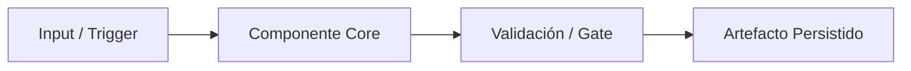
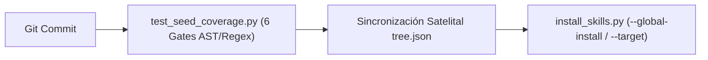

# Gravity HyperScale Thinking

## MASTER THINKING SEED SPECIFICATION (v5.0 — iContext Federation Protocol)

> **Propósito:** Generar un vector arquitectónico autosuficiente, verificable, determinista y portable de un proyecto de software (`01_seed/seed-[proyecto]-master.md`) sincronizado con el índice AST `./.context/contracts_ast.json` y el Bus Cognitivo Federado `./.context/icontext_bus.json`. El resultado permite que cualquier modelo de lenguaje o agente autónomo (Claude, GPT, Gemini, Cursor, Windsurf, Copilot), sin acceso al IDE ni al repositorio completo, comprenda la intención, arquitectura, contratos simbólicos, operación, estado real, superficie de tensión, contradicciones y modos de falla del sistema con cero ambigüedad y 99%+ de ahorro de tokens.

---

# A. CONTRATO DE GENERACIÓN DEL SEED (v5.0)

## A.1 Rol del agente generador
Actúa como **Lead Systems Architect, Principal Context Engineer y Auditor Forense de Software**. Inspecciona el repositorio y construye una representación fiel y adversarial de su estado real.

No te limites a listar nombres de archivos ni caigas en autocomplacencia. Debes conectar componentes, extraer firmas simbólicas de contratos, auditar tensiones arquitectónicas y distinguir con rigor entre:
- hechos observados directamente en código o manifiestos (`[CONFIRMADO]`);
- inferencias lógicas sustentadas en señales estructurales (`[INFERIDO]`);
- afirmaciones presentes en documentación pero no contrastadas o divergentes del código (`[DECLARADO]`);
- comportamientos que requieren ejecución en vivo o credenciales externas (`[NO VERIFICADO]`);
- funcionalidades, archivos o validaciones esperadas que están ausentes (`[FALTANTE]`).

## A.2 Invariantes de Ingeniería v5.0 (Cumplimiento Estricto)

1. **Contrato de Frontera XML (`<SEED_ARCHITECTURAL_VECTOR>`):**
   Todo Seed generado DEBE abrir y cerrar con la etiqueta XML de directiva de sistema:
   `<SEED_ARCHITECTURAL_VECTOR version="5.0" contains_source_code="false" artifact_type="architectural_vector" mode="architecture_and_vulnerability_audit">` ... `</SEED_ARCHITECTURAL_VECTOR>`.
   Esto evita que preprocesadores de chats externos ignoren los comentarios HTML o traten el Seed como un repositorio de código truncado.
2. **Invariante "Zero Source Code / Symbolic Contracts Only":**
   Queda **estrictamente prohibido** incluir bloques de código fuente de implementación (`.py`, `.ps1`, `.sh`, `.rs`, `.go`, `.sql`, `.json`, `.yaml` literales) mayores a 5 líneas dentro del Seed.
   - **Únicos bloques cercados permitidos:**
     * El bloque `yaml` de metadatos en la Sección `0`.
     * El bloque `text` del árbol de directorios en la Sección `2`.
     * Los diagramas `mermaid` en las Secciones `2`, `3` y `6`.
     * El bloque `markdown` de plantilla de respuesta en la Sección `10`.
   - Todo módulo, script, clase, función o CLI se documenta exclusivamente mediante **Firmas Simbólicas AST de 1 línea**:
     `ruta/modulo.py::funcion(arg: Tipo) -> Retorno | Invariante / Efecto / Excepciones`.
3. **Invariante "Zero Local Absolute Paths & Zero File-Scheme URIs":**
   Queda **estrictamente prohibido** incluir rutas absolutas del sistema anfitrión (unidades locales `C` o `D`, `/Users/`, `/home/`) o enlaces con esquema `file` de triple barra en cualquier parte del Seed.
   - El campo `repository_root` en la Sección `0` debe ser siempre `"./"`.
   - Toda referencia a archivos debe usar rutas relativas limpias con separador Unix (`./ruta/archivo.ext` o `ruta/archivo.ext`).
4. **Poda Polimórfica en las 11 Secciones Core (`0` a `10`):**
   El Seed se estructura en **11 Secciones Core obligatorias (`0` a `10`)** que consolidan las 21 dimensiones analíticas clásicas. Los **Sub-Módulos Condicionales** (marcados como `[CONDICIONAL]`) solo se despliegan si existe evidencia física en el repositorio; si no aplican, se omiten o se declaran en una sola línea concisa sin tablas vacías de `"No aplica"`.
5. **Regla DRY Intra-Seed (Cero Redundancia):**
   Cada archivo, contrato, restricción (`[INV-XX]`) o decisión arquitectónica (`[ADR-XXX]`) se define exhaustivamente una sola vez y se referencia por su identificador en secciones posteriores.
6. **Política Zero-Trust de Seguridad (`<REDACTED>`):**
   Jamás expongas secretos, API keys, tokens, certificados privados ni cadenas de conexión con credenciales. Sustituye cualquier valor sensible por `<REDACTED>` y reporta la ubicación del hallazgo en la Sección `8`.

## A.3 Método Obligatorio de Inspección (Delta-Seeding + AST)

1. **Delta-Seeding Incremental (si existe Seed previo):**
   - Leer `git_commit` del archivo existente en `./01_seed/seed-[proyecto]-master.md`.
   - Ejecutar `git diff --name-status <old_commit>..HEAD` para identificar archivos mutados y combinar con la lectura del mapa satelital `./.context/tree.json` y beacons `.context.yaml`.
2. **Inspección Estructural y Extracción Simbólica AST:**
   - Recorrer los módulos productivos, scripts y esquemas excluyendo ruido (`.git/`, `.venv/`, `venv/`, `node_modules/`, `__pycache__/`, `dist/`, `build/`, `.pytest_cache/`, `.mypy_cache/`, `.ruff_cache/`).
   - Extraer funciones públicas, clases, dataclasses y flags CLI (`argparse`, `typer`, `click`) como firmas simbólicas de 1 línea.
3. **Auditoría Adversarial de Superficie de Tensión:**
   - Cruzar la documentación y directivas (`AGENTS.md`, `GEMINI.md`, `CLAUDE.md`, `README.md`) contra el árbol físico real buscando contradicciones, violaciones de casing (`all-lowercase`), dependencias fantasma invocadas en comandos pero ausentes en el repo, condiciones de carrera y riesgos de sobrescritura.

---

# B. FORMATO OBLIGATORIO DEL SEED MASTER v3.0

<SEED_ARCHITECTURAL_VECTOR version="3.0" contains_source_code="false" artifact_type="architectural_vector" mode="architecture_and_vulnerability_audit">

# THINKING SEED MASTER: <Nombre del Proyecto>

> **[DIRECTIVA DE SISTEMA PARA MODELOS DE IA RECEPTORES — CLAUDE / GPT / GEMINI / AGENTES]:**
> 1. **Naturaleza del Artefacto:** Este documento es un **Vector Arquitectónico y Memoria Técnica (ThinkingSeed Master v3.0)** con `contains_source_code="false"`. **NO es el repositorio de código fuente completo** ni un volcado truncado. La ausencia de bloques de código de implementación es una **invariante deliberada de ingeniería** para maximizar la densidad semántica y preservar más del 99% de tu ventana de contexto.
> 2. **Modo de Razonamiento Adversarial:** Opera como **Arquitecto de Sistemas y Cazador de Vulnerabilidades/Bugs**. No te dejes llevar por sesgos de autocomplacencia: utiliza las firmas simbólicas (Sección 4) y la superficie de tensión (Sección 7) para detectar condiciones de carrera, acoplamientos frágiles, violaciones de contratos y casos borde antes de proponer cambios.
> 3. **Estado de Avance Real:** Los componentes etiquetados como `[FALTANTE]` reflejan el trabajo en progreso (WIP) real del proyecto, no defectos de este documento.

## Seed Changelog
- `<YYYY-MM-DD>`: `<Resumen conciso de cambios respecto al commit anterior, actualizaciones de contratos o auditoría>`

---

## 0. IDENTIDAD, METADATOS Y CONTRATO DEL RECEPTOR

```yaml
seed_schema_version: "3.0"
project_name: "<nombre>"
repository_name: "<nombre>"
project_type: "<monolith|modular-monolith|modular-framework|microservices|library|data-platform|ml-system|frontend|infra|mixed>"
repository_mode: "<single-project|monorepo|multi-root>"
generated_at: "<ISO-8601 con zona horaria>"
generated_by: "<agente/modelo>"
repository_root: "./"
git_branch: "<rama o unknown>"
git_commit: "<hash corto o unknown>"
working_tree_state: "<clean|dirty|unknown>"
analysis_mode: "<static|static+git|static+git+validated>"
coverage_level: "<high|medium|low>"
known_analysis_limits:
  - "<limitación verificada>"
```

### 0.1 Instrucciones para el modelo receptor
1. **ADN vs Repositorio:** Reconoce este documento como la memoria técnica y el ADN del proyecto (`contains_source_code="false"`), no como el repositorio completo ni como una prueba de ejecución en vivo.
2. **Contexto Pasivo y Quirúrgico:** No generes código no solicitado ni reclames por archivos ausentes; espera instrucciones específicas del usuario o utilízalo como Ground Truth para responder consultas técnicas.
3. **Estado de Avance:** Considera que los elementos marcados como `[FALTANTE]` representan el avance real del proyecto y oportunidades de asistencia, no errores del documento.
4. **Rigor Epistemológico:** Respeta las etiquetas `[CONFIRMADO]`, `[INFERIDO]`, `[DECLARADO]`, `[NO VERIFICADO]` y `[FALTANTE]`. No conviertas inferencias en hechos.
5. **Portabilidad de Rutas:** Cita siempre rutas relativas a la raíz del repositorio (`./ruta/archivo`) usando `/` como separador. Prohibido emitir rutas locales absolutas o enlaces con esquema `file` local.
6. **Preservación de Contratos:** Respeta las firmas simbólicas declaradas en la Sección 4 y las invariantes `[INV-XX]` antes de proponer modificaciones.
7. **Postura Adversarial Constructiva:** Revisa siempre la Sección 7 (Superficie de Tensión) para anticipar regresiones, bloqueos de I/O o impactos laterales.
8. **Seguridad Zero-Trust:** Nunca reveles, inventes ni solicites secretos reales; utiliza siempre el marcador `<REDACTED>`.

---

## 1. RESUMEN EJECUTIVO Y ALCANCE

### 1.1 Proyecto en una frase
`<Qué construye, para quién, mediante qué arquitectura y con qué resultado verificable>` `[CONFIRMADO]`

### 1.2 Objetivos principales y problema que resuelve
- **[CONFIRMADO]** `<Objetivo 1 y problema específico que erradica>` — *Evidencia:* `<ruta:líneas>`
- **[CONFIRMADO]** `<Objetivo 2>` — *Evidencia:* `<ruta:líneas>`

### 1.3 Alcance y límites del sistema
- **Dentro del alcance (`In-Scope`):** `<Capacidades implementadas y verificadas>`
- **Fuera del alcance (`Out-of-Scope`):** `<Límites explícitos y responsabilidades delegadas>`

### 1.4 Principios de diseño e invariantes no negociables
- **`[INV-01]`** `<Nombre de invariante>`: `<Descripción técnica verificable>` `[CONFIRMADO]`
- **`[INV-02]`** `<Nombre de invariante>`: `<Descripción técnica verificable>` `[CONFIRMADO]`

### 1.5 Capacidades principales y criterios de éxito
| Capacidad | Estado | Componente / Entry Point | Métrica / Criterio de Éxito | Evidencia |
|---|---|---|---|---|
| `<capacidad>` | `<Completa|Parcial|Stub|Faltante>` `[ETIQUETA]` | `<ruta>` | `<métrica cuantitativa o gate>` | `<ruta>` |

---

## 2. ARQUITECTURA, TOPOLOGÍA Y FRONTERAS MODULARES

### 2.1 Patrón arquitectónico y vista general
`<Descripción del estilo arquitectónico, capas, bounded contexts y modelo de ingesta de contexto>` `[CONFIRMADO]`

### 2.2 Árbol estructural anotado (`all-lowercase` invariant)
```text
./
├── <carpeta>/             # [prio] Responsabilidad concisa
│   └── <archivo>          # Rol específico del archivo
└── ...
```

### 2.3 Catálogo de componentes y fronteras modulares
| Componente | Tipo | Responsabilidad | Entry point | Depende de | Consumido por | Madurez |
|---|---|---|---|---|---|---|
| `<nombre>` | `<skill|cli|engine|schema|doc>` | `<responsabilidad>` | `<ruta>` | `<dependencias>` | `<consumidores>` | `<estado>` `[ETIQUETA]` |

### 2.4 Desambiguación de carpetas y archivos críticos
- **Diferenciaciones clave:** `<Explicación de carpetas con nombres similares o roles complementarios>`
- **Fuentes de verdad vs Artefactos generados:** `<Distinción entre archivos editables manualmente y salidas sincronizadas por herramientas>`

| Ruta Crítica | Por qué es crítica | Consumidor principal | Riesgo de modificación |
|---|---|---|---|
| `<ruta>` | `<motivo>` | `<consumidor>` | `<Crítico|Alto|Medio|Bajo>` |

### 2.5 Stack tecnológico
| Capa | Tecnología | Versión | Finalidad | Fuente de verificación |
|---|---|---|---|---|
| `<Runtime/Core/Format>` | `<tecnología>` | `<versión>` | `<finalidad>` | `<ruta>` |

---

## 3. FLUJOS DE EJECUCIÓN, ENTRY POINTS Y CICLO DE VIDA

### 3.1 Entry points registrados
| Escenario / Operación | Entry point | Trigger / Comando simbólico | Salida / Efecto en disco | Evidencia |
|---|---|---|---|---|
| `<escenario>` | `<ruta::símbolo>` | `<comando o evento>` | `<artefacto o mutación>` | `<ruta:líneas>` |

### 3.2 Flujo principal de extremo a extremo (Grafo de Ejecución)

- **Secuencia algorítmica:** `<Pasos numerados concisos indicando input, transformación, persistencia y manejo de error por etapa>`

### 3.3 Ciclo de vida de datos/artefactos, concurrencia e idempotencia
- **Génesis, transformación y persistencia:** `<Ciclo completo de los artefactos>`
- **Estado, concurrencia e idempotencia:** `<Garantías stateless/stateful, comportamiento ante re-ejecución y manejo de escrituras en disco>`

---

## 4. CONTRATOS SIMBÓLICOS, MODELO DE DATOS Y PERSISTENCIA

> **Nota de Invariante `[INV-02]`:** Prohibido volcar código fuente. Todo contrato público se expresa como firma simbólica tipada de 1 línea.

### 4.1 Tabla de Firmas Simbólicas AST y Contratos CLI
| Ruta del Módulo | Símbolo Público / CLI Flag | Firma Simbólica Tipada (1 línea) | Invariante / Efecto / Excepciones |
|---|---|---|---|
| `<ruta.py>` | `<funcion_o_clase>` | `modulo::simbolo(arg: Tipo) -> Retorno` | `<Invariante, mutación en disco o código de salida>` `[CONFIRMADO]` |
| `<ruta.py>` | `<--flag-cli>` | `CLI Flag (--flag: tipo, default=X)` | `<Efecto exacto sobre el flujo de ejecución>` `[CONFIRMADO]` |

### 4.2 Contratos de datos y esquemas (Schemas)
| Entidad / Artefacto | Formato / Schema | Claves Requeridas / Estructura Simbólica | Origen -> Destino | Regla de Validación |
|---|---|---|---|---|
| `<nombre>` | `<YAML/JSON/MD>` | `<claves y tipos en 1 línea>` | `<origen -> destino>` | `<validador>` |

### 4.3 Almacenes de persistencia
| Almacén | Tecnología | Contenido | Política de Acceso / Retención | Evidencia |
|---|---|---|---|---|
| `<nombre>` | `<Filesystem/Git/DB>` | `<contenido>` | `<lectura/escritura/gitignore>` | `<ruta>` |

### 4.4 Sub-Módulos Condicionales `[CONDICIONAL: Omitir o resumir en 1 línea si no existe evidencia física]`
- **4.4.1 Eventos, Colas y Mensajería Asíncrona:** `<Productores, tópicos, consumidores y DLQ si existen; de lo contrario declarar en 1 línea arquitectura síncrona orientada a archivos>`.
- **4.4.2 Migraciones, Bootstrap y Linaje de Datos:** `<Secuencia de inicialización/bootstrap y control de deriva/freshness>`.

---

## 5. CONFIGURACIÓN, ENTORNOS Y DEPENDENCIAS

### 5.1 Variables de configuración y constantes operativas
| Variable / Constante | Tipo | Requerida | Default Seguro | Efecto Operativo | Sensible | Evidencia |
|---|---|---|---|---|---|---|
| `<NOMBRE>` | `<Path/str/bool>` | `<Sí/No>` | `<valor o <REDACTED>>` | `<efecto>` | `<Sí/No>` | `<ruta:líneas>` |

### 5.2 Precedencia de configuración y matriz de entornos
- **Orden de precedencia:** `<Ej: Flags CLI > Reglas locales de workspace > Configuración global de usuario > Defaults en plantilla>`
- **Matriz de entornos:** `<Comportamiento diferenciado entre Desarrollo Local, Instalación Global OS e Inyección en Target Repo>`

### 5.3 Dependencias internas, externas y resolución de motores externos
- **Grafo de dependencias internas:** `<Relaciones directas entre skills, plantillas y scripts>`
- **Dependencias externas y motores satelitales:**

| Dependencia / Motor | Versión | Naturaleza | Ubicación / Resolución | Fallback Local Autónomo |
|---|---|---|---|---|
| `<Python Stdlib / Git / Motor externo>` | `<versión>` | `<Runtime / Binario externo>` | `<PATH / Repo hermano>` | `<Mecanismo de fallback nativo verificado>` |

---

## 6. PRUEBAS, CI/CD, DESPLIEGUE Y OPERACIÓN

### 6.1 Estrategia de pruebas y cobertura
| Suite / Validador | Ubicación | Qué audita / cubre | Comando simbólico de ejecución | Estado |
|---|---|---|---|---|
| `<nombre>` | `<ruta>` | `<cobertura AST, rutas, secretos, esquema>` | `<comando>` | `<Activo/Parcial/Faltante>` `[ETIQUETA]` |

### 6.2 Quality Gates y CI/CD
- **Gates deterministas de salida:** `<Condiciones booleanas que deben cumplirse antes de cualquier commit o release>`
- **Pipeline de validación y distribución:**


### 6.3 Sub-Módulo Condicional: Observabilidad, Health Checks y Runbooks `[CONDICIONAL]`
- **Convenciones de logging y señales operativas:** `<Prefijos semánticos, métricas emitidas y archivos de reporte>`
- **Health checks y procedimientos de recuperación (Runbooks):** `<Secuencia declarativa de diagnóstico y reparación sin bloques de código redundantes>`

---

## 7. SUPERFICIE DE TENSIÓN, CONTRADICCIONES Y MODOS DE FALLA (AUDITORÍA ADVERSARIAL)

> **Propósito Adversarial:** Esta sección elimina el sesgo de autocomplacencia y expone los puntos frágiles, supuestos no verificados y vectores de falla reales donde un modelo receptor o ingeniero debe extremar precauciones.

### 7.1 Fronteras de confianza (Trust Boundaries) y entradas no confiables
- `<Análisis de argumentos CLI, rutas de usuario, archivos leídos sin validación de esquema o inyecciones potenciales de prompt/path>`

### 7.2 Acoplamientos implícitos, concurrencia y estado mutable compartido
- `<Riesgos de sobrescritura en disco, bloqueos de archivos en Windows NTFS, falta de locks atómicos o acoplamiento entre nombres de archivo y scripts>`

### 7.3 Contradicciones detectadas (Declarado vs Observado en Árbol Físico)
- `<Lista explícita de divergencias entre documentación/reglas y la implementación física, o registro de divergencias recién corregidas que deben vigilarse para evitar regresión>`

### 7.4 Dependencias externas asumidas en `PATH` o repositorios hermanos
- `<Análisis de binarios o scripts invocados en documentación (ej. FWengine.py, query_graph.py, git) que pueden no existir en el entorno del consumidor y cómo opera el fallback>`

### 7.5 Matriz de modos de falla y recuperación
| ID | Modo de Falla / Vector | Síntoma Observable | Causa Raíz | Detección | Mitigación / Recuperación | Riesgo Residual Real |
|---|---|---|---|---|---|---|
| `FAIL-01` | `<falla>` | `<síntoma>` | `<causa>` | `<validador/señal>` | `<acción>` | `<Bajo/Medio/Alto + motivo técnico real (prohibido poner "Nulo" sin justificación)>` |

---

## 8. SEGURIDAD, PRIVACIDAD Y GUARDRAILS

### 8.1 Postura Zero-Trust y manejo de secretos
- `<Política de sanitización <REDACTED>, exclusiones en .gitignore/.agentignore y validación determinista anti-fugas>`

### 8.2 Superficie de ataque y controles implementados
- `<Controles contra Path Traversal, ejecución arbitraria, supply-chain (0 dependencias de terceros) y contaminación de contexto>`

### 8.3 Hallazgos de seguridad (Security Findings)
| Severidad | Vector / Hallazgo | Evidencia | Impacto Potencial | Mitigación / Estado |
|---|---|---|---|---|
| `<Crítica/Alta/Media/Baja/Info>` | `<descripción sin secretos>` | `<ruta:líneas>` | `<impacto>` | `<control aplicado>` |

---

## 9. ESTADO REAL, DEUDA TÉCNICA Y DECISIONES (ADRs)

### 9.1 Matriz Declarado vs Observado
| Área / Módulo | Declarado en Documentación | Observado en Repositorio | Estado Real | Evidencia |
|---|---|---|---|---|
| `<área>` | `<declarado>` | `<observado>` | `<Completo / Parcial / Scaffolding [FALTANTE]>` | `<ruta>` |

### 9.2 Trabajo pendiente (`[FALTANTE]`) y deuda técnica priorizada
| ID | Prioridad | Componente / Deuda o Pendiente | Impacto | Criterio de Cierre Verificable |
|---|---|---|---|---|
| `DEBT-01` | `<P0-P3>` | `<descripción>` | `<impacto>` | `<condición booleana de cierre>` |

### 9.3 Registro de Decisiones Arquitectónicas (`[ADR-XXX]`)
| ID | Decisión Arquitectónica | Motivo / Problema | Alternativa Descartada | Consecuencia / Trade-off | Estado / Evidencia |
|---|---|---|---|---|---|
| `ADR-001` | `<decisión>` | `<motivo>` | `<alternativa>` | `<consecuencia>` | `Aceptada [CONFIRMADO]` — `<ruta>` |

### 9.4 Incertidumbres activas y preguntas abiertas
- `<Aspectos que dependen de evolución futura o decisiones de arquitectura pendientes>`

---

## 10. REGLAS DE MODIFICACIÓN, GLOSARIO E ÍNDICE DE EVIDENCIAS

### 10.1 Reglas obligatorias para modificar el proyecto y Checklist Pre-Commit
1. `<Regla 1 alineada con invariantes [INV-XX]>`
2. `<Regla 2>`
- **Checklist Pre-Commit Determinista:**
  - [ ] `<Verificación 1>`
  - [ ] `<Verificación 2>`

### 10.2 Formato recomendado para responder solicitudes técnicas
```markdown
## Entendimiento de la solicitud
## Componentes afectados (rutas relativas ./)
## Supuestos, riesgos de tensión (Sección 7) e incertidumbres
## Solución propuesta y contratos simbólicos afectados
## Implementación propuesta
## Pruebas, validación y criterios de aceptación
```

### 10.3 Glosario del dominio
| Término | Definición precisa en este proyecto | No confundir con | Evidencia |
|---|---|---|---|
| `<término>` | `<definición>` | `<distinción>` | `<ruta>` |

### 10.4 Índice de evidencias y cobertura del análisis
| Ruta Relativa | Tipo de Artefacto | Relevancia Arquitectónica | Estado Observado |
|---|---|---|---|
| `<./ruta>` | `<Spec/Script/Config/Map>` | `<qué demuestra>` | `<Vigente / Scaffolding>` |

| Área Evaluada | Cobertura | Confianza | Método de Verificación |
|---|---|---|---|
| Arquitectura y Topología | `<Alta/Media/Baja>` | `<Alta/Media/Baja>` | `<Inspección + check_local_tree_freshness>` |
| Contratos Simbólicos AST | `<Alta/Media/Baja>` | `<Alta/Media/Baja>` | `<ast.parse en check_ast_contract_coverage>` |
| Portabilidad y Seguridad | `<Alta/Media/Baja>` | `<Alta/Media/Baja>` | `<Regex determinista Zero-Paths / Zero-Leaks>` |

---

## 📌 CONTEXT HANDOFF & PROTOCOLO DE ASISTENCIA

> **Mensaje de orientación para el modelo de IA receptor:**
> "Esto es una semilla de proyecto (**ThinkingSeed Master v3.0**): el vector arquitectónico y ADN del proyecto (`contains_source_code="false"`), no su repositorio de código completo. Refleja el avance real, los contratos simbólicos y la superficie de tensión del sistema hasta la fecha. Como modelo receptor, tu función es usar esta semilla como memoria técnica para:
> 1. **Responder preguntas** sobre la arquitectura, contratos simbólicos, dependencias y flujos del sistema.
> 2. **Auditar riesgos y sugerir mejoras** evaluando activamente la Superficie de Tensión (Sección 7) y las áreas marcadas como `[FALTANTE]`.
> 3. **Generar código o soluciones compatibles** respetando estrictamente las rutas relativas (`./`), firmas simbólicas e invariantes definidas aquí, cuando el usuario te lo solicite."

### Pautas de resolución:
Antes de resolver una solicitud:
1. Identifica el objetivo del usuario.
2. Localiza los componentes afectados usando las rutas relativas (`./`) del Seed.
3. Revisa restricciones (`[INV-XX]`), decisiones (`[ADR-XXX]`), contratos simbólicos (Sección 4) y vectores de tensión (Sección 7).
4. Explicita supuestos cuando sea necesario: *"Supongo que X debido a Y"*.
5. Propone cambios por archivo con rutas relativas claras y separadores Unix (`/`).
6. Añade pruebas, riesgos de regresión y criterios de aceptación verificables.

### 🤝 Acuse de Recibo Inicial
Si el usuario adjuntó esta semilla **sin una instrucción específica**, no intentes generar código ni completar archivos vacíos. Responde únicamente con:
1. Un saludo confirmando que asimilaste el ADN arquitectónico v3.0 de **[Nombre del Proyecto]** (`<SEED_ARCHITECTURAL_VECTOR>`) y su stack principal.
2. Un breve resumen de 2-3 líneas sobre el propósito del sistema, su estado actual y sus principales vectores de tensión.
3. Una frase poniéndote a disposición para auditar, resolver dudas o colaborar en los siguientes pasos de desarrollo.

</SEED_ARCHITECTURAL_VECTOR>

---

# C. CHECKLIST DE AUTO-VALIDACIÓN PRE-EMISIÓN (GATE DEL AGENTE GENERADOR)

Antes de guardar el archivo en `./01_seed/seed-[proyecto]-master.md`, el agente generador DEBE verificar:
- [ ] **Gate 1 (Frontera XML y Handoff):** El documento inicia con `<SEED_ARCHITECTURAL_VECTOR version="3.0" contains_source_code="false" ...>`, contiene la sección `0.1 Instrucciones para el modelo receptor`, incluye `## 📌 CONTEXT HANDOFF & PROTOCOLO DE ASISTENCIA` y cierra con `</SEED_ARCHITECTURAL_VECTOR>`.
- [ ] **Gate 2 (Zero Source Code):** Cero bloques de código fuente de implementación (`.py`, `.ps1`, `.sh`, `.json`, `.yaml` literales > 5 líneas). Todos los scripts y módulos están representados mediante firmas simbólicas AST de 1 línea en la Sección 4.1.
- [ ] **Gate 3 (Zero Local Paths & Zero File URIs):** `repository_root` es `"./"` y existen **0 coincidencias** de URIs con esquema `file` local, letras de unidad de disco (`C` o `D`) o rutas de usuario (`/Users/`, `/home/`).
- [ ] **Gate 4 (Zero-Trust `<REDACTED>`):** Ningún secreto, token o credencial aparece en texto plano.
- [ ] **Gate 5 (Auditoría Adversarial):** La Sección 7 documenta tensiones, contradicciones y modos de falla reales sin caer en el sesgo de `"Riesgo Nulo / 100% Mitigado"`.
- [ ] **Gate 6 (Validación Cuantitativa):** Si `./scripts/test_seed_coverage.py` está presente, ejecutar `python scripts/test_seed_coverage.py --target-repo . --no-anonymize` y confirmar código de salida `0`.
